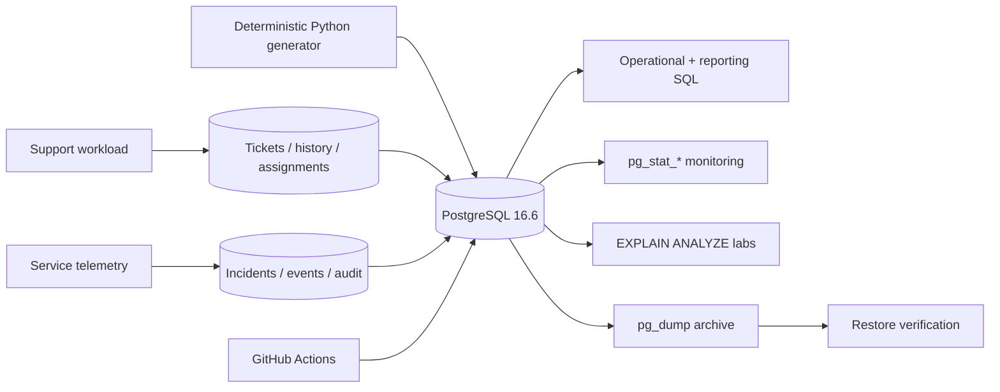

<h1 align="center">PostgreSQL Operations Lab</h1>

<p align="center">
  Production-style PostgreSQL operations, SQL engineering, performance tuning, and troubleshooting environment.
</p>

<p align="center">
  
  
  
  
  
  
</p>

A reproducible database-operations portfolio built around a fictional SaaS support platform. The repository demonstrates normalized relational design, operational SQL, troubleshooting, query-plan analysis, transactions, migrations, PostgreSQL-native monitoring, backup/restore workflows, deterministic synthetic data, automated database testing, and CI validation.

Everything runs locally with Docker Compose. All included records are synthetic and use reserved/non-real identifiers such as `example.invalid`.

## Architecture



## Quick start

Requirements: Docker with the Compose plugin and `make`.

```bash
cp .env.example .env
make up
make generate
make test
```

The database is exposed on `localhost:${POSTGRES_PORT:-5432}`. A fresh Docker volume automatically applies the numbered migrations and reference data. `make generate` then loads the deterministic synthetic workload.

Useful commands:

```bash
make validate
make monitor
make performance
make backup
make down
```

## Key capabilities

| Area | Demonstrated implementation |
| --- | --- |
| Relational design | PK/FK relationships, unique/check constraints, normalized dimensions and operational history |
| SQL development | joins, subqueries, CTEs, recursive CTEs, aggregates, `HAVING`, windows/ranking, JSONB, views |
| Operations | SLA risk, unresolved workload, stale tickets, inactive customers, assignment workload, history |
| Performance | reproducible before/after plans, missing indexes, composite ordering, N+1 replacement, index inventory |
| Transactions | `BEGIN`, `COMMIT`/`ROLLBACK` workflow, row locks, isolation concepts, deadlock reproduction |
| Reliability | guarded migrations, deterministic seeds, database assertions, restore verification |
| Monitoring | activity, long queries, locks, sizes, index usage, connections, transaction statistics |
| Automation | Python data generation, strict Bash utilities, Docker Compose, GitHub Actions |

## Operational scenarios

The query library answers concrete support and production questions rather than presenting disconnected SQL syntax examples:

- unresolved tickets grouped by priority;
- tickets at risk of or past an SLA target;
- current agent workload and P1 concentration;
- tickets without recent updates;
- inactive customer organizations;
- historical status transitions;
- ticket volume and resolution-time analysis;
- repeatedly reopened tickets;
- incident category and service frequency;
- duplicate-record candidates;
- long-running transactions and blocking sessions.

See [Operational Queries](docs/operational-queries.md) and the [Troubleshooting Runbooks](docs/troubleshooting.md).

## Performance optimization

`performance/` contains executable labs that capture actual local plans instead of committing fake benchmark values.

```bash
make generate DATA_TICKETS=50000
make performance
```

The scripts demonstrate `EXPLAIN`, `EXPLAIN (ANALYZE, BUFFERS)`, sequential/index access decisions, missing indexes, composite-index ordering, set-based replacement for N+1 access, and index-usage inspection. Generated plan output is stored under `.artifacts/performance/` and is intentionally ignored by Git.

See [Performance](docs/performance.md).

## Backup and recovery

The standalone utilities under `backup/` use PostgreSQL-native tooling:

- timestamped custom-format `pg_dump` archives;
- strict error handling and environment validation;
- partial-file cleanup and archive validation;
- retention cleanup scoped to the configured backup directory;
- guarded restore into an explicit empty target;
- isolated restore verification with automatic cleanup.

See [Backup and Restore](docs/backup-restore.md).

## CI/CD

`.github/workflows/ci.yml` starts PostgreSQL 16.6 and performs the checks actually implemented in this repository:

1. Python compile validation;
2. Bash syntax checks and ShellCheck;
3. Docker Compose configuration validation;
4. migrations applied twice;
5. reference seed applied twice;
6. deterministic synthetic dataset generation;
7. database tests;
8. execution of the operational SQL library;
9. smoke execution of all performance SQL.

No credentials, coverage values, uptime claims, benchmark results, or build-status claims are hardcoded into the README.

## Documentation

| Document | Focus |
| --- | --- |
| [Architecture](docs/architecture.md) | Runtime shape, data flow, design boundaries |
| [Data Model](docs/data-model.md) | ER diagram, integrity, schema rationale |
| [Operational Queries](docs/operational-queries.md) | Query library and execution model |
| [Performance](docs/performance.md) | Before/after plan methodology |
| [Transactions](docs/transactions.md) | Safe updates, isolation, deadlock reproduction |
| [Migrations](docs/migrations.md) | Ordering and practical idempotency |
| [Backup and Restore](docs/backup-restore.md) | Backup safety and restore verification |
| [Troubleshooting](docs/troubleshooting.md) | Ten evidence-driven incident runbooks |
| [Testing](docs/testing.md) | Constraint, relationship, view, routine, and CI tests |

## Security and limitations

- All user, organization, ticket, incident, and event records are synthetic.
- Synthetic emails use the reserved `example.invalid` domain.
- Local defaults in `.env.example` are development-only credentials; `.env` is ignored by Git.
- Backup scripts rely on PostgreSQL environment variables or `.pgpass` and do not put passwords in command-line arguments.
- This repository demonstrates logical backup/restore, not WAL archiving or point-in-time recovery.
- Performance results depend on local hardware, cache state, PostgreSQL settings, and generated data volume; the repository generates evidence rather than claiming fixed timings.
- The project is an operations lab, not a production SaaS application or a claim of production uptime/scale.

## License

MIT. See [LICENSE](LICENSE).
