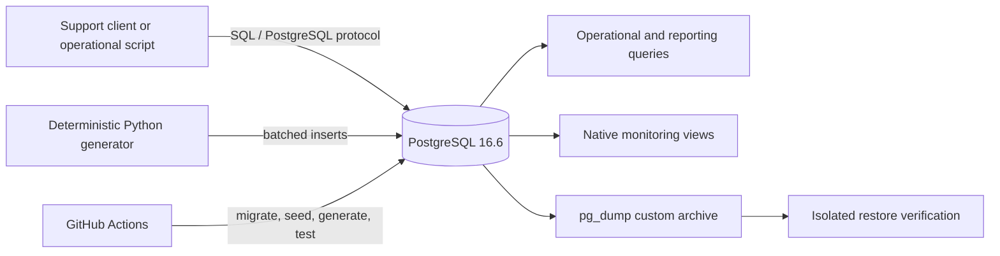

# Architecture

## Runtime shape

PostgreSQL is the only required stateful service. Docker Compose provides a persistent local volume and a health check. Schema definitions are canonical under `schema/`, `functions/`, and `procedures/`; numbered files under `migrations/` reference those definitions so migration order is explicit without duplicating SQL.

## Data flow

1. PostgreSQL starts and applies numbered migrations on a new Docker volume.
2. Reference dimensions are loaded from `seed/001_reference_data.sql`.
3. `scripts/generate_data.py` creates deterministic fictional organizations, users, agents, tickets, activity, incidents, events, and audit entries.
4. Operational queries inspect current workload; reporting queries aggregate historical behavior.
5. Monitoring SQL reads PostgreSQL native statistics.
6. Performance scripts create temporary copies where needed, capture real `EXPLAIN (ANALYZE, BUFFERS)` output, then roll back.
7. Backup scripts create custom-format archives and can verify them through an isolated restore.

## Design boundaries

The lab deliberately avoids external observability stacks, ORMs, application frameworks, and cloud-specific services. That keeps the repository focused on PostgreSQL operations, SQL behavior, reproducibility, and evidence-driven troubleshooting.
