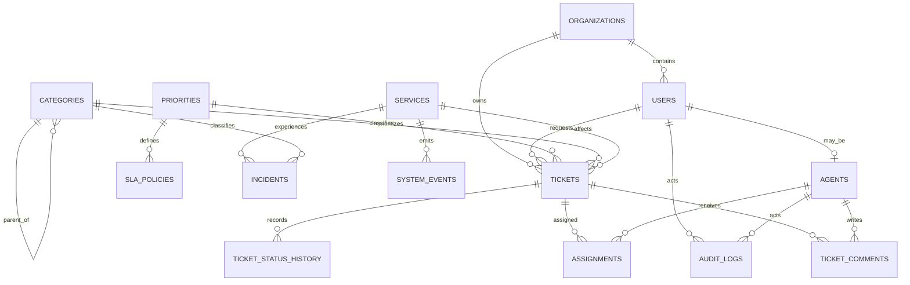

# Data Model

The schema separates customer identity, support workflow, service incidents, and operational evidence. Foreign keys use restrictive behavior for master data and cascading behavior for ticket-owned history where deleting the parent makes the child meaningless.

## Major choices

| Choice | Reason |
| --- | --- |
| Surrogate identity keys | Stable joins and compact foreign keys while keeping natural identifiers unique. |
| Text status plus check constraints | Keeps the allowed state set explicit without coupling migrations to PostgreSQL enum alteration semantics. |
| JSONB metadata only for variable attributes | Core searchable relationships remain normalized; flexible channel/event details can vary without sparse columns. |
| Partial unique assignment index | Enforces at most one active assignment per ticket while preserving assignment history. |
| Partial worklist index | Targets unresolved-ticket operations without indexing resolved rows unnecessarily. |
| Composite indexes | Match common predicates and sort order used by organization, service, priority, and history queries. |
| `TIMESTAMPTZ` | Operational timestamps represent instants consistently across clients and environments. |
| Ticket-owned history cascades | Comments, status history, and assignments are meaningless without their ticket. Master dimensions remain protected by restrictive foreign keys. |

## Integrity

Checks protect status values, severity ranges, chronological fields, SLA targets, and author/actor cardinality. Foreign keys prevent orphaned operational records. Unique constraints protect slugs, emails, service keys, priority codes, and policy combinations.
